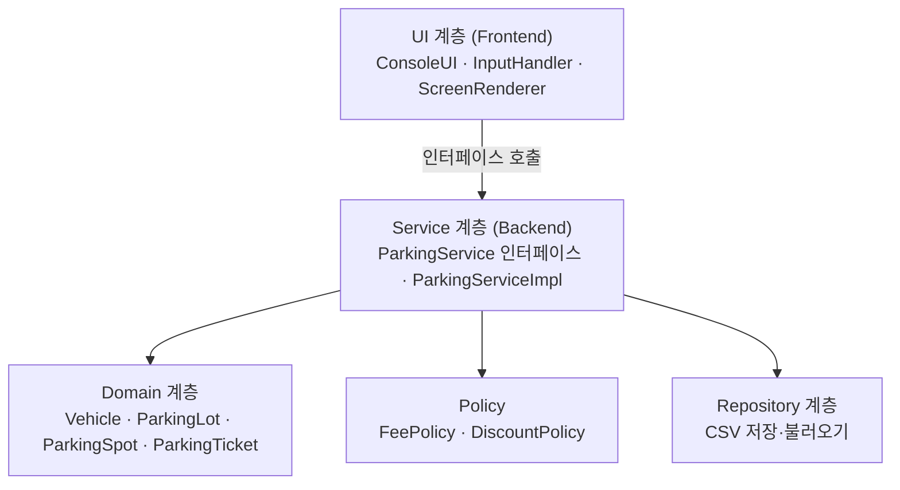
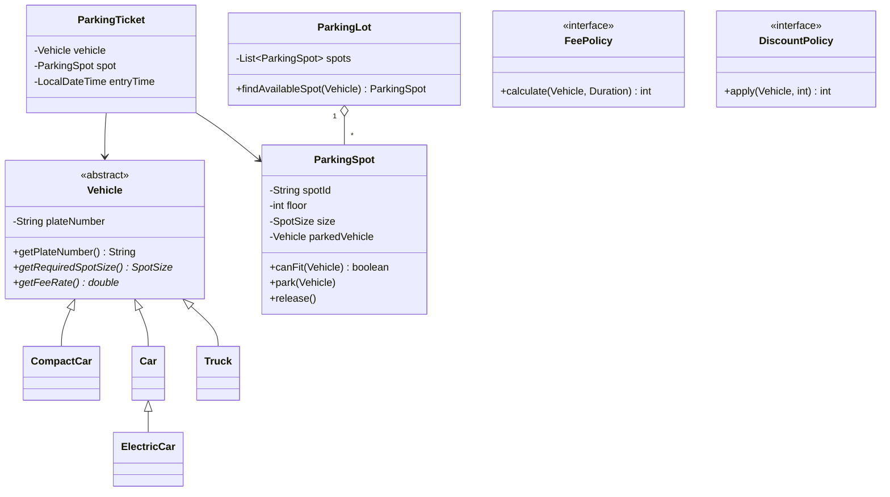

# 🅿️ 주차장 관리 시스템 (Parking Lot Management System)

> 소프트웨어공학 기말 팀 프로젝트 — 프로젝트 제안서

---

## 1. 팀 구성

| 구분 | 이름 | GitHub ID | 담당 |
|---|---|---|---|
| 팀원 1 | 김동형 | dongbro-png | Frontend (콘솔 UI·입출력·화면 출력) |
| 팀원 2 | 박찬영 | newsa12 | Backend (도메인·비즈니스 로직·데이터) |

---

## 2. 주제 선택

- **카테고리:** 자동차 관리 시스템 (`Vehicle.java` 활용)
- **주제:** 주차장 관리 시스템. 입차 → 주차면 배정 → 출차 → 요금 정산 → 이력·매출 관리까지 처리하는 콘솔 기반 프로그램
- **사용 언어:** Java

### 선택 이유

1. **요구사항을 분명하게 정의할 수 있다.** 입차, 출차, 정산, 조회는 누가(관리자) 무엇을 하는지가 분명합니다. 그래서 작업 명세서의 Use Case Diagram과 기능 명세를 구체적으로 쓰기 쉽습니다.
2. **수업에서 배운 객체지향 개념이 자연스럽게 들어간다.** 차량 종류별로 크기와 요금이 다르므로 상속·다형성(6주차)이 필요합니다. 요금·할인 규칙은 인터페이스로 바꿔 끼울 수 있게 만듭니다(7주차). 차량번호로 조회할 때는 `Map`(9주차), 정기권 차량 관리에는 `Set`(10주차)을 씁니다. 억지로 끼워 넣지 않아도 필요한 곳에 쓰입니다.
3. **Frontend와 Backend의 경계가 분명해서 2인 분담에 적합하다.** "사용자 입력을 받고 결과를 보여주는 쪽"과 "주차 규칙을 처리하고 데이터를 관리하는 쪽"을 하나의 인터페이스로 나눌 수 있습니다. 두 사람이 같은 파일을 동시에 고칠 일이 적습니다.

---

## 3. 시스템 개요

주차장 관리자가 콘솔 메뉴로 사용하는 프로그램입니다.

```
===== 주차장 관리 시스템 =====
1. 입차      2. 출차·정산    3. 차량 조회
4. 주차 현황  5. 정기권 관리   6. 매출 리포트
7. 저장      0. 종료
```

- 주차장은 **여러 층**으로 이루어지고, 각 층에는 **크기가 다른 주차면**(소형·일반·대형)이 있습니다.
- 차량 종류에 맞는 빈 주차면을 **자동으로 배정**합니다.
- 출차할 때 **주차 시간, 차량 종류, 할인 조건**에 따라 요금을 계산하고 영수증을 출력합니다.
- 프로그램을 종료해도 데이터가 남도록 **파일(CSV)에 저장**하고 다시 불러옵니다.

---

## 4. 구현 기능

| ID | 기능 | 설명 | 우선순위 |
|---|---|---|---|
| F-01 | 입차 처리 | 차량번호·차종 입력 → 맞는 크기의 빈 주차면 자동 배정 → 입차 시각 기록 | 필수 |
| F-02 | 출차·요금 정산 | 주차 시간 계산 → 요금 정책 적용 → 영수증 출력 → 주차면 반납 | 필수 |
| F-03 | 차량 조회 | 차량번호로 위치(층·주차면), 입차 시각, 현재까지의 예상 요금 조회 | 필수 |
| F-04 | 주차 현황 표시 | 층별 주차면 상태를 텍스트 맵으로 출력 (예: `[ ]` 빈칸, `[C]` 승용, `[T]` 트럭) | 필수 |
| F-05 | 요금 정책 | 기본 무료 시간, 단위 시간당 요금, 일 최대 요금, 차종별 요금 계수 | 필수 |
| F-06 | 할인 정책 | 경차·전기차 할인 등 할인 규칙을 독립적으로 추가·교체할 수 있는 구조 | 필수 |
| F-07 | 정기권 관리 | 정기권 차량 등록·해지·조회, 정기권 차량은 출차 시 요금 면제 | 필수 |
| F-08 | 이력·매출 리포트 | 입출차 이력 저장, 일별 매출 합계와 차종별 매출 집계 | 필수 |
| F-09 | 데이터 저장·불러오기 | 주차 현황·정기권·이력을 CSV 파일로 저장하고 시작할 때 불러오기 | 필수 |
| F-10 | 예외 처리 | 만차, 중복 입차, 주차 기록이 없는 차량의 출차, 잘못된 입력 형식 처리 | 필수 |
| F-11 | 시간 시뮬레이션 | 시연할 때 입차·출차 시각을 직접 지정해 요금 계산 결과 확인 | 선택 |
| F-12 | 주차면 배정 전략 선택 | "가까운 층 우선", "빈 곳 많은 층 우선" 등 배정 방식 교체 | 선택 |

### 수업·과제 대비 확장 내용

| 수업·과제에서 다룬 내용 | 이 프로젝트에서 확장하는 내용 |
|---|---|
| `Vehicle` – `Car` / `Bike`의 `move()` 오버라이드 (6주차) | 차량 종류별로 **차지하는 주차면 크기와 요금 계수**가 다른 다형성 구조 |
| `interface Playable`, `Payable` (7주차) | `FeePolicy`, `DiscountPolicy`, `SpotAllocationStrategy` 인터페이스로 **규칙을 바꿔 끼울 수 있게** 설계 |
| `abstract class GameCharacter` (HW6) | `abstract class Vehicle`을 부모로 두고 차종별 클래스가 상속 |
| `Map<String, Student>` 조회 (9주차) | `Map<String, ParkingTicket>`으로 **차량번호 기준 즉시 조회** |
| `Set` 합집합·차집합 (10주차) | 정기권 차량을 `Set`으로 관리, `contains()`로 정기권 여부 판별 |
| `MoneyOwner` 송금 (HW) | 출차 정산 시 **주차면 반납·요금 기록·이력 저장이 함께 처리**되도록 하나의 메서드로 묶음 |
| (새로 추가) | 파일 입출력(CSV), 사용자 정의 예외, `LocalDateTime`/`Duration` 시간 계산, 계층 구조(UI–Service–Repository) |

---

## 5. 시스템 구조 (초안)

### 5.1 계층 구조



UI는 `ParkingService` **인터페이스만** 알고 내부 구현은 모릅니다. Backend가 내부를 바꿔도 인터페이스가 그대로면 UI 코드는 고칠 필요가 없습니다.

### 5.2 핵심 클래스 (초안)



> 과제에서 제공한 `Vehicle.java`를 부모 클래스로 사용합니다. 제공 코드의 필드·메서드는 유지하고, 주차에 필요한 메서드(`getRequiredSpotSize()`, `getFeeRate()` 등)를 추가하는 방향으로 확장합니다. 정확한 클래스 구조는 작업 명세서(SRS)에서 확정합니다.

---

## 6. 팀원 간 핵심 인터페이스

두 사람이 **가장 먼저 합의하는 약속**입니다. Frontend는 이 인터페이스의 메서드만 호출하고, Backend는 이 인터페이스를 구현합니다.

```java
public interface ParkingService {

    // 입차: 빈 주차면을 배정하고 주차권 반환 (만차면 ParkingFullException)
    ParkingTicket parkVehicle(String plateNumber, VehicleType type, LocalDateTime entryTime);

    // 출차: 요금을 정산하고 영수증 반환 (기록 없으면 VehicleNotFoundException)
    Receipt exitVehicle(String plateNumber, LocalDateTime exitTime);

    // 차량번호로 현재 주차 정보 조회
    ParkingTicket findByPlate(String plateNumber);

    // 층별 주차면 상태 (화면 출력용)
    List<SpotStatus> getFloorStatus(int floor);

    // 정기권 등록·해지
    void registerMembership(String plateNumber);
    void cancelMembership(String plateNumber);

    // 일별 매출 리포트
    DailyReport getDailyReport(LocalDate date);

    // 데이터 저장·불러오기
    void save();
    void load();
}
```

### 데이터 전달 규칙

- **결과 전달:** Backend는 `ParkingTicket`, `Receipt`, `SpotStatus`, `DailyReport` 같은 **읽기 전용 객체**(필드는 `private final`, getter만 제공)를 돌려줍니다. UI가 받은 객체로 주차장 상태를 직접 바꿀 수 없게 하기 위해서입니다.
- **오류 전달:** 실패는 `null`이나 `-1` 같은 특수값이 아니라 **사용자 정의 예외**로 알립니다. UI는 예외를 잡아 사용자에게 안내 메시지를 보여줍니다.

```
ParkingException (RuntimeException 상속)
 ├─ ParkingFullException       : 맞는 크기의 빈 주차면 없음
 ├─ DuplicateEntryException    : 이미 주차 중인 차량번호로 입차 시도
 └─ VehicleNotFoundException   : 주차 기록이 없는 차량의 출차·조회
```

---

## 7. 역할 분담

Frontend / Backend 기준으로 나누고, 인터페이스를 경계로 각자 병렬로 개발합니다.

| 구분 | 팀원 1 (Backend) | 팀원 2 (Frontend) |
|---|---|---|
| 담당 영역 | 도메인 모델, 비즈니스 로직, 데이터 저장 | 콘솔 UI, 입력 처리, 화면 출력 |
| 주요 작업 | • `Vehicle` 상속 구조와 차종별 클래스<br>• `ParkingLot`, `ParkingSpot`, 주차면 배정 알고리즘<br>• `ParkingServiceImpl` (입차·출차·조회·정기권·리포트)<br>• `FeePolicy`, `DiscountPolicy` 구현<br>• CSV 저장·불러오기<br>• 사용자 정의 예외 | • 메인 메뉴와 하위 메뉴 흐름<br>• 입력 검증 (차량번호 형식, 메뉴 번호, 날짜·시각)<br>• 층별 주차 현황 텍스트 맵 출력<br>• 영수증·조회 결과·매출 리포트 출력<br>• 예외 메시지 안내 화면<br>• 시연용 시나리오 정리 |
| 공동 작업 | `ParkingService` 인터페이스와 데이터 객체 정의, 작업 명세서(UML 포함), README, 최종 발표 | ← 동일 |

### 병렬 개발 방법

Frontend는 개발 첫 주에 실제 로직 대신 정해진 값을 돌려주는 **임시 구현(`StubParkingService`)**으로 화면을 먼저 완성합니다. Backend의 `ParkingServiceImpl`이 완성되면 생성 코드 한 줄만 바꿔 연결합니다. 이렇게 하면 한쪽이 끝날 때까지 다른 쪽이 기다리지 않아도 됩니다.

```java
// 개발 초기
ParkingService service = new StubParkingService();
// 통합 이후
ParkingService service = new ParkingServiceImpl(lot, feePolicy, discountPolicy, repository);
```

---

## 8. 개발 환경 및 협업 방식

| 항목 | 내용 |
|---|---|
| 언어 / JDK | Java (JDK 17 이상) |
| IDE | Eclipse 또는 IntelliJ IDEA |
| 저장소 | GitHub (팀원 2명 모두 Collaborator로 등록) |
| 브랜치 | `main` (제출용) ← `develop` (통합) ← `feature/기능명` (개인 작업) |
| 코드 반영 | 기능 단위로 Pull Request → 상대 팀원 리뷰 후 `develop`에 병합 |
| 작업 관리 | GitHub Issues에 기능 ID(F-01 등)별 작업 등록, 완료 시 PR과 연결 |
| 커밋 규칙 | `feat:` 기능 추가 · `fix:` 버그 수정 · `docs:` 문서 · `refactor:` 구조 개선 |

> 평가 기준에 **커밋 빈도와 커밋한 사용자 ID**가 포함되므로, 두 팀원 모두 기능을 작은 단위로 나눠 자주 커밋합니다.

---

## 9. 진행 일정

| 단계 | 기간 | Backend | Frontend |
|---|---|---|---|
| 작업 명세서 + 개발 착수 | 11/23 ~ 11/29 | 클래스 다이어그램, 인터페이스 확정, 도메인 모델·차종별 클래스 작성 | Use Case 다이어그램, 화면 흐름 정의, 메뉴 골격·Stub 연동 |
| 핵심 기능 개발 | 11/30 ~ 12/3 | 주차면 배정, 입차·출차, 요금·할인 정책 | 입력 검증, 입출차·조회 화면, 현황 맵 출력 |
| 부가 기능 개발 | 12/4 ~ 12/6 | 정기권, 매출 리포트, CSV 저장 | 정기권·리포트 화면, 예외 안내 |
| 통합·마무리 | 12/7 ~ 12/8 | Stub → 실제 구현 교체, 통합 테스트, README 작성, 발표 자료 제출(12/8) | ← 공동 |
| 최종 발표 | 12/9 | 아키텍처·핵심 인터페이스 설명, 실행 데모 시연 | ← 공동 |

> 작업 명세서 1차 마감은 11/29이며, 이후에도 개발 내용에 맞춰 계속 업데이트합니다.

---

## 10. 최종 결과물

- GitHub 저장소의 **완성된 Java 소스 코드**와 커밋 이력
- **README.md** — 실행 방법, 메뉴별 사용 설명, 실행 예시
- **작업 명세서(SRS)** — 기능 명세, 데이터 규격, 핵심 인터페이스, Use Case / Class Diagram
- **최종 발표 자료** — 전체 아키텍처, 모듈 분담 구조, 핵심 인터페이스, 실행 데모
